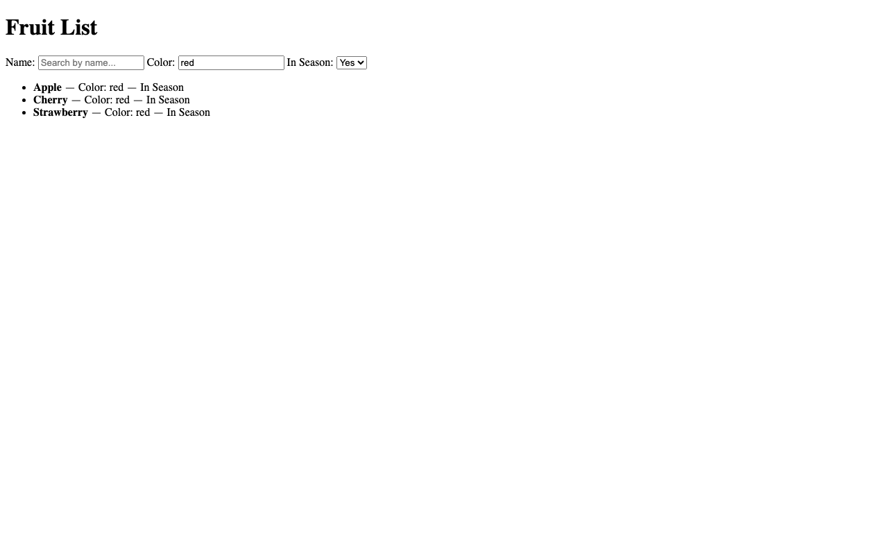

# Fruit List (full-stack coding challenge)

React + Vite frontend, FastAPI + PostgreSQL backend, nginx reverse proxy with response caching. Fruit from `fruitList.json` is served at `GET /fruit` and can be filtered by `name`, `color` and `in_season`, with the filters kept in the page URL.



*The real UI served by `docker compose up --build`, opened at `http://localhost:3000/?color=red&in_season=true`.*

## Run

Requires Docker with Compose.

```bash
docker compose up --build
```

- Frontend: http://localhost:3000
- API (via nginx): http://localhost:8080/fruit (Swagger at http://localhost:8080/docs)
- Postgres is also published on host port 5432; stop any local Postgres first.

Frontend dev server (needs the stack above running, since `App.jsx` calls `http://localhost:8080`):

```bash
cd frontend && npm install && npm run dev   # http://localhost:3000
npm run build                               # production build to frontend/dist
```

## API

`GET /fruit` returns `[{"name": "Apple", "color": "red", "in_season": true}]`.

| Param | Behavior |
|---|---|
| `name` | case-insensitive substring match |
| `color` | case-insensitive substring match |
| `in_season` | `true` / `false` |

Example: `/fruit?color=red&in_season=true`. Responses are cached by nginx for 10 seconds per URL.

## Extras

- `autoscaler.py`: scales the `backend` service between 2 and 10 replicas from `docker stats` CPU (`python autoscaler.py`, stack running).
- `stress-test.sh`: autocannon load phases against nginx, reports saved in `stress-results/`.
- Design notes: [APPROACH.md](APPROACH.md).

## Original challenge brief

### Project Description

We are asking you to use a JSON blob that represents a list of fruit, return it from a backend API and then
to create a list in the UI that shows the fruit name, their color, and whether or not they are in season.

You should be able to filter the fruit by querystring to show only fruit of a certain color, AND OR
whether the fruit is in season or not.

### Acceptance Criteria

1. Create your backend webserver
2. Create an API that returns the JSON found in `fruitList.json`
   1. Postman collection (not included in this repo)
3. Create a simple frontend that fetches the list of fruit from your backend API and loads it into the application state
4. In a list, render the names of the fruit, their colors, and whether or not they are in season or not
5. In the query string allow the user to filter fruit by:
   1. In season or not (`in_season`)
   2. Their color (`color`)
   3. Partial search on name (can be anywhere within the string) (`name`) (example: `app` => `apple`); other examples would be `APP` or `aPp`
6. Ability to change the querystring filters from the UI

### Examples

**Filtering by Color / in Season / Name:**

```
Example 1: /fruit?color=red
Example 2: /fruit?in_season=true
Example 3: /fruit?color=red&in_season=true
Example 4: /fruit?name=app
```

### Stretch Goals

The sky is the limit for customization of this challenge. Here are a few ideas to get you started.

1. Style the frontend
2. Add a database
3. Add tests